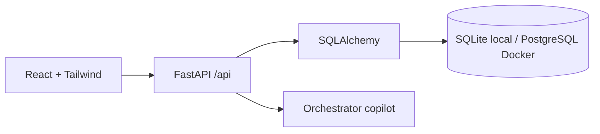

# Arhitectură

## Flux principal

Frontend-ul folosește React Router. Funcțiile de acces la backend sunt în `frontend/src/api/client.js`. În dezvoltare, Vite face proxy pentru `/api`; vezi `frontend/vite.config.js`.

Backend-ul pornește din `backend/app/main.py`. La startup inițializează schema, execută seed-ul general și apoi completează profilurile financiare demo lipsă. Configurarea bazei se află în `backend/app/config.py` și `backend/app/database.py`.

## Model financiar

| Tabel | Rol | Legătură |
| --- | --- | --- |
| `clients` | Identitate și câmpuri financiare vechi | `id` |
| `financial_profiles` | Salariu, venit, monedă, familie, dată, origine, versiune | `client_id` este PK și FK către `clients.id` |
| `client_expenses` | Categorie, sumă lunară, status, notă de evidență | FK către `financial_profiles.client_id` |
| `client_credits` | Creditor, tip, sumă inițială, sold, rată lunară, dobândă și termen | FK către `financial_profiles.client_id` |

Profilul deține colecțiile de cheltuieli și credite prin relații SQLAlchemy cu `delete-orphan`. Sumele financiare noi folosesc `Numeric`; API-ul le validează prin `Decimal` în `backend/app/financial_schemas.py`.

`financial_profile_revisions` păstrează snapshot-uri înainte și după editare. `schema_migrations` înregistrează versiunile aplicate din `backend/app/migrations`. Modificările existente sunt păstrate la migrarea `cnp` și la adăugarea metadatelor financiare.

## Contract și UI

- `GET /api/clients/{id}/financial-profile`: profilul existent sau 404.
- `PUT /api/clients/{id}/financial-profile`: creează sau înlocuiește integral profilul și colecțiile sale; clientul trebuie să existe. Actualizările cer `expected_version`, iar SQLAlchemy verifică versiunea la scriere.
- `/clients/:id/finances`: pagina React pentru vizualizare și editare.
- Seed-ul financiar este în `backend/app/financial_seed.py` și nu suprascrie profiluri existente.

UI-ul calculează venitul ca salariu + venit suplimentar. Ieșirile lunare însumează cheltuielile declarate/confirmate și ratele creditelor active/restante. Suspiciunile sunt afișate separat. Aceste calcule de prezentare nu înlocuiesc analiza de credit din copilot.

Pentru pornire și exemple de payload, vezi [README.md](README.md). Pentru convenții de dezvoltare, vezi [AGENTS.md](AGENTS.md).

Originea unui profil este păstrată separat în `source_kind`; `is_demo` se schimbă după o editare. Moneda unui profil existent este blocată în API și UI. Routerul folosește `createBrowserRouter` pentru blocarea navigării prin sidebar și Back când există editări nesalvate; închiderea/reîncărcarea este protejată prin `beforeunload` unde browserul permite.
