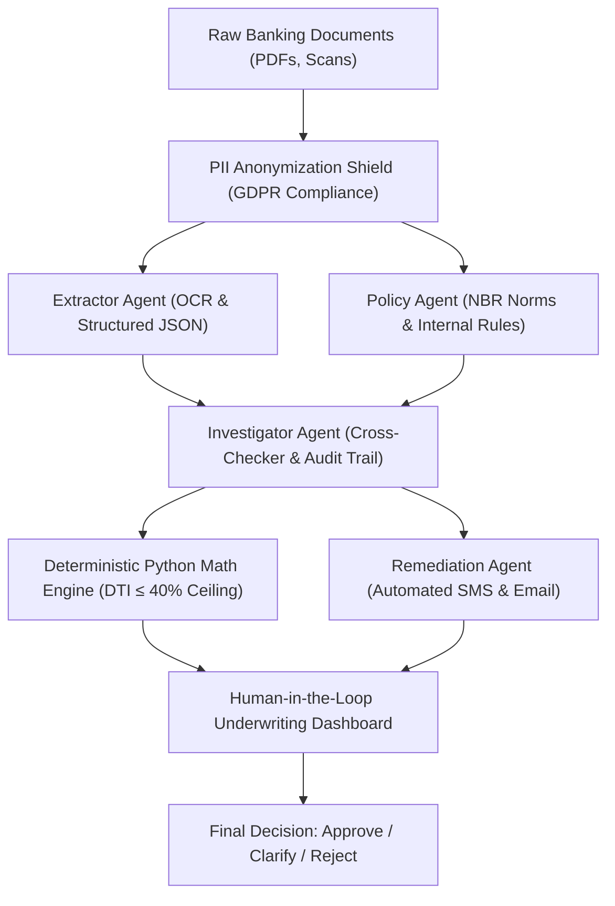

# BankDesk & Raiffeisen AI Copilot — Triage & Audit

Project documentation: [agent instructions](AGENTS.md), [current progress](PROGRESS.md),
[next steps](TODO.md), [architecture](ARCHITECTURE.md).

A fullstack application (FastAPI backend, React + Tailwind CSS frontend, PostgreSQL / SQLite database, Docker compose) built for the **Raiffeisen Bank Hackathon — Operational Efficiency Challenge**.

The project unites:
1. **The Host Banking Application (`BankDesk`)**: The internal banking system used by credit officers (*Consultant 024*) — an exact recreation of the dark-mode dashboard from the official specification, complete with case portfolio management, client directory, underwriting verification forms (manual data entry), numbered line-by-line document viewers, operational checklists, and regulatory audit logging.
2. **The Multi-Agent AI Extension (`Raiffeisen AI Copilot — Triage & Audit`)**: A slide-over copilot drawer engineered as a non-intrusive plugin for existing banking systems. It orchestrates a specialized cascade of AI agents to cut case verification time from **45 minutes down to ~3 seconds**.

---

## 🤖 Multi-Agent Architecture (Raiffeisen AI Copilot)

When the loan officer opens a credit case and clicks **"Run AI Review"** inside the Copilot panel, the orchestrator (`backend/app/agents/orchestrator.py`) executes the following multi-agent pipeline:



### Multi-Agent Pipeline Components:

1. **PII Anonymization Shield (GDPR Compliance)**:
   - Pseudonymizes sensitive personal information (National ID / Tax ID, Passport / ID Serial numbers, IBANs, Phone numbers, Personal Emails) prior to LLM analysis.
   - Restores values exclusively in the local authenticated officer view with clear audit tracking.
2. **Parallel Agent Execution (`Extractor Agent` $\parallel$ `Policy Agent`)**:
   - **Agent 1 — Extractor (OCR & Data Structuring)**: Parses attached documents into strict JSON structures, retaining **exact document sources, line numbers (`Line X`), and verbatim citations**.
   - **Agent 2A — Policy Agent (Regulatory Norms & Internal SOPs)**: Matches active internal credit policies (`PROC-KYC-01`, `PROC-DOC-02`, `PROC-INC-03`, `NBR-NORM-DTI-04`) to the specific case type.
3. **Agent 2B — Investigator (Cross-Checker) + Deterministic Math Engine**:
   - **100% Explainability (Audit Trail)**: Cross-checks data across documents and flags **Red Flags** (discrepancies, expired dates) and **Green Flags** (validations). Every finding features clickable citations that immediately jump to and highlight the exact document line in the viewer.
   - **Deterministic Python Financial Math (`calculate_feasibility_math`)**: Monthly payment calculations (annuity formula) and the **Debt-to-Income (DTI) ratio (capped at 40% per National Bank regulations)** are calculated deterministically in standard Python code, strictly avoiding LLM math hallucinations.
4. **Agent 3 — Remediation Agent & Human-in-the-Loop Workflow**:
   - For critical edge cases (e.g., *Expired National ID Card* or conflicting employer statements), automatically drafts and dispatches **SMS and Email notices with secure upload links** to the applicant, resolving blockers without manual officer intervention.
   - **Human-in-the-Loop Control**: AI prepares the triage dossier; the final credit decision remains with the authorized loan officer, who can confirm findings, select validated figures (triggering instant Python DTI recalculation), and click *Approve Case*, *Request Clarification*, or *Reject Case*.

---

## 🎯 3 Pre-Configured Live Demo Scenarios

| Case ID | Title & Status | Applicant | Demo Scenario for the Hackathon Jury |
| :--- | :--- | :--- | :--- |
| **Case #10482** | *Mortgage Loan Application* (`In review`) | **John Miller** | **Scenario 1 — Cross-Check Discrepancies**:<br>• **Income Mismatch**: `5,200 RON` declared on Loan Application (*Line 8*) vs `5,700 RON` verified on Income Certificate (*Line 9*) and Bank Statement (*Line 8*).<br>• **Name Mismatch**: `John Miller` on National ID (*Line 4*) vs `Jonathan Miller` on Income Certificate (*Line 4*).<br>• *Interactive test*: Click citations to see line highlighting; pick `5,700 RON` as the validated figure to watch the Python DTI recalculate live (`17.92%` $\rightarrow$ `16.35%`). |
| **Case #10475** | *Account Opening & Overdraft* (`Pending`) | **Michael Scott** | **Scenario 2 — Critical Edge Case (Expired ID)**:<br>• The applicant's National ID expired on `10.02.2026` (*Line 7*), and the residential utility bill address differs from the ID card.<br>• **Remediation Agent** auto-intervenes, preparing an **SMS + Email with a secure upload link** for the customer. |
| **Case #10479** | *Client Data Update & Refinancing* (`Completed`) | **Elena Radu** | **Scenario 3 — 100% Clean Green Flag Dossier**:<br>• Perfect concordance across all documents (*Elena Radu*, verified income `6,800 RON`, valid National ID, DTI `17.83%` < `40%` ceiling), pre-screened and ready for 1-click human sign-off. |

---

## 🔌 Plug & Play Architecture

The Copilot is engineered as a decoupled extension:
- **Zero Core-Banking Overhaul**: Operates as a sidecar / drawer overlay that embeds seamlessly into any web-based banking LOS (Loan Origination System), CRM (e.g. Salesforce Financial Services Cloud), or legacy terminal.
- **RESTful API Contract**: Connects to existing bank backends via standard JSON endpoints (`/api/cases/{caseId}/analysis`, `/api/analyses/{id}/findings/{findingId}`, etc.).
- **Dual Display Modes**: Offers both a responsive **50/50 Split-View** (simultaneous document comparison and copilot review) and an **Expanded Full-Width Mode** for laptops and tablets.

---

## ⚡ Quick Start

### Option A — Docker Compose (Recommended)

```bash
docker compose up --build
```

- **BankDesk Web Frontend**: [http://localhost:3001](http://localhost:3001) (or `http://localhost:3000`)
- **FastAPI Backend & Interactive Swagger API Docs**: [http://localhost:8000/docs](http://localhost:8000/docs)

### Option B — Local Development Run

1. **Start Backend (FastAPI)**:
   ```bash
   cd backend
   python -m uvicorn app.main:app --reload --port 8000
   ```
2. **Start Frontend (Vite + React)**:
   ```bash
   cd frontend
   npm run dev -- --port 5173
   ```
   Access the frontend at [http://localhost:5173](http://localhost:5173).

---

## 🛠️ API Reference

- `GET /api/dashboard/stats` — Case metrics summary (`in_progress`, `to_verify`, recent cases).
- `GET /api/cases` — List all credit cases with status and search filters.
- `GET /api/cases/{caseId}` — Fetch complete case details, applicant record, documents, tasks, and audit logs.
- `POST /api/cases/{caseId}/analysis` — Trigger the multi-agent AI pipeline.
- `GET /api/cases/{caseId}/analysis` — Retrieve the latest audit report, cross-check findings, DTI math, and remediation draft.
- `PATCH /api/analyses/{analysisId}/findings/{findingId}` — Officer review on a finding (recalculate DTI deterministically).
- `POST /api/analyses/{analysisId}/remediation/send` — Dispatch automated SMS/Email remediation notice.
- `POST /api/analyses/{analysisId}/human-decision` — Record final human-in-the-loop underwriting decision in the regulatory audit trail.

## Client financial database

The database includes `financial_profiles`, `client_expenses`, and `client_credits`,
linked by client ID. Start the backend normally or run `cd backend && python -m app.seed`
to initialize tables and add realistic synthetic financial profiles for all 33 built-in demo
client IDs. Initialization preserves existing records and handles the older `cnp`
column name. Demo seeding never overwrites an existing financial profile.

- `GET /api/clients/{client_id}/financial-profile` reads a profile (404 if absent).
- `PUT /api/clients/{client_id}/financial-profile` creates or replaces the full profile,
  including its expense and credit lists. Omitted lists become empty.

Example PUT body:

```json
{
  "monthly_salary": "5200.00",
  "other_monthly_income": "200.00",
  "currency": "EUR",
  "marital_status": "married",
  "number_of_children": 2,
  "as_of_date": "2026-10-28",
  "expenses": [
    {"category": "housing", "monthly_amount": "1000.00", "verification_status": "declared"},
    {"category": "sports_betting", "monthly_amount": "180.00", "verification_status": "suspected", "evidence_note": "Merchant category requires verification"}
  ],
  "credits": [
    {"lender": "Example Bank", "credit_type": "personal_loan", "original_amount": "20000.00", "remaining_balance": "12000.00", "monthly_payment": "350.00", "remaining_term_months": 36, "interest_rate_annual": "8.5", "status": "active"}
  ]
}
```

Amounts use fixed precision decimals and the profile's currency. Salary is net monthly
salary; expenses are monthly amounts or estimates as of the supplied date. Suspected
expenses remain explicitly unverified; `dismissed` is available for rejected signals.
Profiles carry an `is_demo` flag; submitting a PUT marks the profile as user supplied.
Financial profiles are separate snapshots and do not automatically overwrite the
legacy client income/debt fields or change AI underwriting decisions.

Open **Clients → Financial profile** to view or edit income, household details,
monthly expenses and loans. Summary cards separate suspected expenses from recorded
outgoings. Add or remove entries, then select **Save financial profile**.

Run financial persistence and validation checks from `backend`:
`../venv/bin/python -m unittest discover -s tests -v`.
