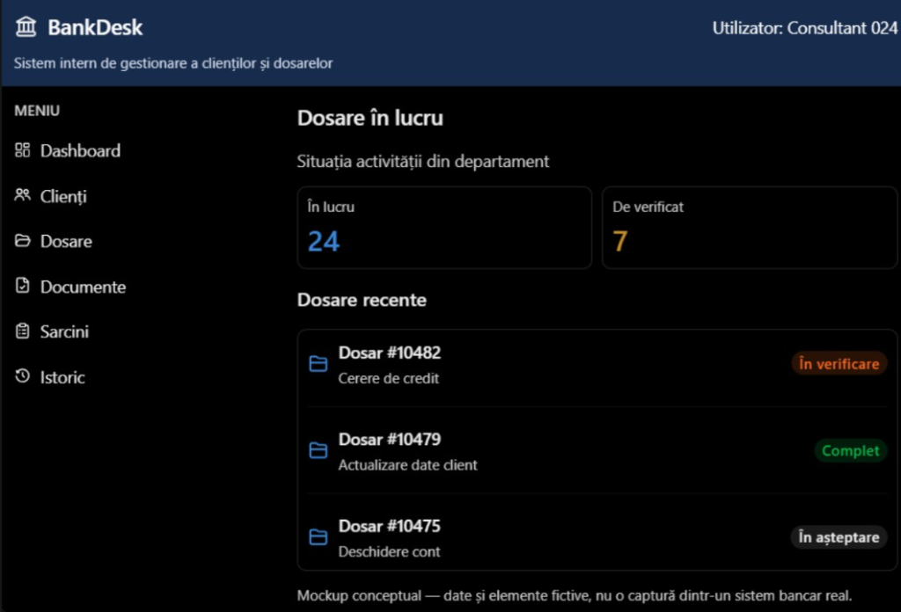

# BankDesk — Sistem Intern de Gestionare a Clienților și Dosarelor

Aplicație fullstack enterprise (Backend, Frontend, Bază de Date PostgreSQL, Docker) construită pe baza machetei BankDesk și a specificațiilor de proiect Raiffeisen Bank — Operational Efficiency.



---

## 🏛️ Descriere Proiect

**BankDesk** este o platformă web internă utilizată de angajații băncii (ex. *Consultant 024*) pentru:
- Monitorizarea activității din departament (*Dosare în lucru*, *De verificat*);
- Gestionarea dosarelor de creditare și actualizare date clienți;
- Consultarea documentelor justificative atașate (cereri, adeverințe de venit, extrase de cont, cărți de identitate);
- Urmărirea sarcinilor operaționale și a istoricului complet (audit trail).

> **Notă:** Această versiune reprezintă **aplicația de bază**, decuplată de AI. Structura de date, endpoint-urile API și documentele demonstrative au fost special pregătite pentru a permite conectarea ulterioară a plugin-ului multi-agentic AI descris în documentul tehnic (BankDesk AI).

---

## 🚀 Arhitectură Tehnică

- **Frontend**: React 18, Vite, Tailwind CSS, Lucide Icons, React Router 6. Design dark-mode fidel machetei din captură.
- **Backend**: Python 3.13 + FastAPI, SQLAlchemy 2.0, Pydantic v2.
- **Bază de date**: PostgreSQL 16 (cu fallback automat pe SQLite pentru rulare locală rapidă fără server extern).
- **Containerizare**: Docker & Docker Compose (servicii: `postgres`, `backend`, `frontend` cu Nginx reverse proxy).

---

## 📁 Structura Proiectului

```text
├── docker-compose.yml           # Configurația celor 3 servicii (DB, API, Web)
├── README.md
├── backend/
│   ├── Dockerfile
│   ├── requirements.txt
│   └── app/
│       ├── main.py              # Inițializare FastAPI, CORS, rute
│       ├── config.py            # Variabile mediu & setări
│       ├── database.py          # Conexiune SQLAlchemy
│       ├── models.py            # Modele DB: Client, Case, Document, Task, AuditLog
│       ├── schemas.py           # Validări și DTOs Pydantic
│       ├── seed.py              # Date demonstrative pre-populate (matching mockup)
│       └── routers/             # Endpoint-uri REST
│           ├── dashboard.py     # Statistici (24 în lucru, 7 de verificat, etc.)
│           ├── cases.py         # CRUD dosare & actualizare status
│           ├── clients.py       # Gestiune clienți bancari
│           ├── documents.py     # Documente atașate dosarelor
│           ├── tasks.py         # Sarcini de verificare
│           └── history.py       # Audit trail / jurnal acțiuni
└── frontend/
    ├── Dockerfile
    ├── nginx.conf               # Nginx reverse proxy pentru /api/ și SPA
    ├── package.json
    ├── vite.config.js
    ├── tailwind.config.js
    ├── index.html
    └── src/
        ├── api/client.js        # Serviciu apeluri API
        ├── components/          # Header, Sidebar, Layout general
        └── pages/
            ├── Dashboard.jsx    # Ecranul principal din captură
            ├── CasesList.jsx    # Centralizator dosare & filtrare
            ├── CaseDetail.jsx   # Detalii dosar, documente, sarcini, istoric
            ├── ClientsList.jsx  # Registru clienți
            ├── DocumentsList.jsx# Vizualizator documente
            ├── TasksList.jsx    # To-do operațional
            └── HistoryList.jsx  # Jurnal activități
```

---

## ⚡ Pornire Rapidă cu Docker Compose

Asigurați-vă că aveți Docker Desktop pornit, apoi rulați din rădăcina proiectului:

```bash
docker compose up --build
```

Aplicația va fi accesibilă la:
- **Frontend Web**: [http://localhost:3001](http://localhost:3001) (sau portul configurat în `FRONTEND_PORT`)
- **Backend API Docs (Swagger UI)**: [http://localhost:8000/docs](http://localhost:8000/docs)
- **Baza de date Postgres**: `localhost:5432` (user: `bankuser`, pass: `bankpassword`, db: `bankdesk`)

La prima pornire, baza de date se populează automat cu datele din mockup:
- **Dosar #10482** (*Cerere de credit*, status: `În verificare`, solicitant *Alexandru Ionescu*, documente conținând discrepanța de venit 5.200 vs 5.700 RON);
- **Dosar #10479** (*Actualizare date client*, status: `Complet`);
- **Dosar #10475** (*Deschidere cont*, status: `În așteptare`);
- Statistici exacte: **24 în lucru**, **7 de verificat**.

---

## 💻 Rulare Locală (Fără Docker)

Dacă doriți să dezvoltați sau să rulați direct pe mașina locală:

### 1. Pornire Backend
```bash
cd backend
python -m pip install -r requirements.txt
uvicorn app.main:app --reload --port 8000
```
*(Backend-ul folosește automat SQLite local `bankdesk.db` dacă PostgreSQL nu este configurat în variabila `DATABASE_URL`)*.

### 2. Pornire Frontend
```bash
cd frontend
npm install
npm run dev
```
Frontend-ul va porni la [http://localhost:5173](http://localhost:5173) și se va conecta automat prin proxy la backend-ul de pe portul 8000.

---

## 🔮 Conectarea Viitoare a Plugin-ului Multi-Agentic AI

Această aplicație a fost structurată special pentru a servi drept fundație solidă pentru pasul următor descris în documentul tehnic:
1. **Pagină de detalii dosar** gata prevăzută cu container pentru declanșarea analizei de verificare;
2. **Text extras din documente** stocat direct pe modelele de documente (`Document.content_text`), conținând exact cazul de test propus (Cerere credit: 5.200 RON vs Adeverință angajator: 5.700 RON);
3. **Endpoint-uri decuplate** gata de a apela serviciul de agenți (Extraction Agent, Policy Agent, Verification Agent, Workflow Agent).
